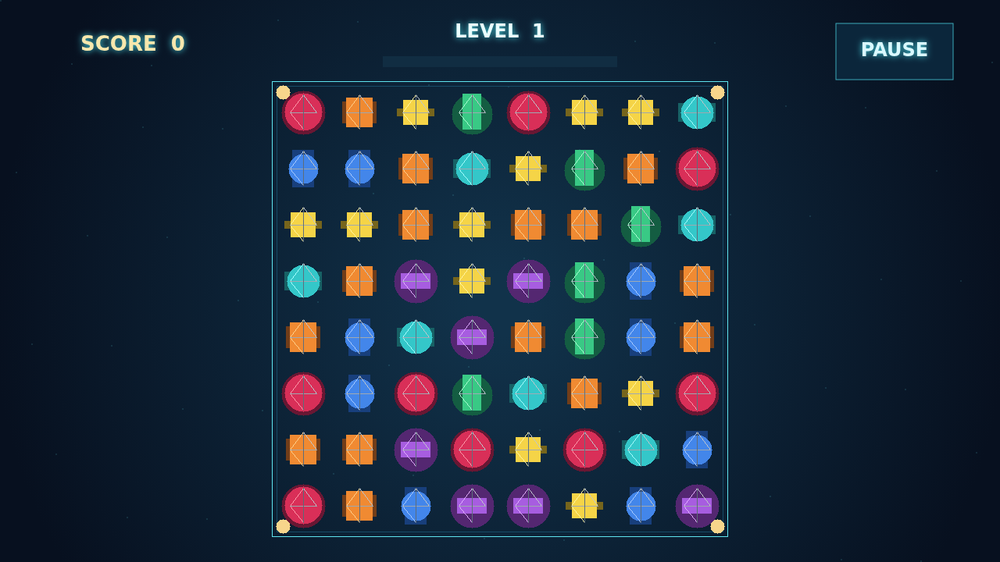

# Facet

Facet is a gem-matching puzzle where every swap can become a fracture line. Drag neighboring stones into rows or columns of three, then watch the gaps collapse and fresh gems tumble into new matches.

Every shatter puts pressure on the gems left beside it. Their cracks deepen until they become flawed; touch a flawed stone with any later clear and it detonates too, scoring double and pushing the chain farther.

Longer and crossing lines leave rare cuts behind. A brilliant takes the ring around it, a star sweeps its entire row and column, and a prism swapped with a gem takes every stone of that kind. Build pressure, spend it at the right moment, and climb through increasingly demanding levels.

